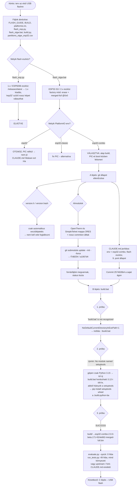

# Első USB flash előkészítése – 2026-11-10

Napló az első ESP flash előtti vizsgálatról és javításokról. Eszköz: NodoShop OTGW v2.13 panel
(PIC 6.8) + LOLIN S3 Mini (ESP32-S3), `sajat` ág (a `dev` 2.x ágból indul), USB: COM5.

## Folyamatábra



## Mit és miért

### 1. Vizsgálat (csak olvasás)

| Kérdés | Eredmény | Forrás |
| --- | --- | --- |
| Hol vannak a doksik? | `docs/guides/FLASH_GUIDE.md`, `docs/guides/BUILD.md` (nem `docs/` alatt) | – |
| Jó-e a `flash_esp.py`? | **Nem.** 1.x / ESP8266 eszköz. A `/releases/latest` végpont kihagyja a prerelease-eket, ezért az 1.x kiadást adja (kódból következtetve, élőben nem próbáltuk). Az `esp32` fájlnév-szűrő az OTGW32-es, a classic és a combo képre is illik. | `flash_esp.py:69`, `:470`; `FLASH_GUIDE.md:3` |
| Mivel flasheljünk? | `flash_otgw.bat` factory mód: teljes törlés, majd egy `*-merged-full.bin` írása 0x0-ra | `flash_otgw.bat:233` |
| Kell külön fájlrendszer-flash? | **Nem.** A merged-full kép tartalmazza: bootloader, partíciós tábla, safeboot, firmware, LittleFS | `build.py:2120-2144` |
| Melyik env? | **`esp32-combo`**. Az `esp32` az OTGW32 (PIC nélkül), a te paneleden nem működne. | `platformio.ini:3-5`, `build.py:13` |
| Partíciók | safeboot 0x10000, app0 0x100000, LittleFS 0x330000, 4 MB flash | `partitions_otgw_esp32.csv` |

### 2. Talált hibák és javításuk

**a) Üres almodulok.** A `src/libraries/OpenTherm` és a `src/libraries/SimpleTelnet` mappában csak
a `.git` hivatkozás volt, forrásfájl nem. A két almodul ráadásul újabb commiton állt, mint amit a repó vár.
Ezek nélkül a build nem fordult volna le. Valószínű ok: félbemaradt klónozás.

```
git submodule update --init --force src/libraries/OpenTherm src/libraries/SimpleTelnet
```

Eredmény: OpenTherm `f7d8254`, SimpleTelnet `a1067d4`, pontosan a `dev` ág hivatkozása szerint.
Az `other-projects` almodult szándékosan nem töltöttük le: SAT referenciakód, a build nem használja.

> Ha egy másik gépen újra klónozol: `git clone --recurse-submodules ...`, vagy klónozás után
> `git submodule update --init src/libraries/OpenTherm src/libraries/SimpleTelnet`.

**b) Hibás env a CLAUDE.md-ben.** Átírva `esp32`-ről `esp32-combo`-ra, és bekerült, hogy a flash
eszköz a `flash_otgw.bat`.

### 3. Commit

- `2574626b4` – *Add fork CLAUDE.md, keep upstream instructions as CLAUDE.upstream.md* (`sajat` ág, nincs pusholva)
- Kimaradt a commitból: `src/OTGW-firmware/version.h`, `data/version.hash`. Ezeket a build automatikusan írja.

### 4. B lépés – build

Két környezeti hiba volt; egyik sem a firmware hibája.

| Tünet | Ok | Megoldás |
| --- | --- | --- |
| `'build.bat' is not recognized as an internal or external command` | A gépen `NoDefaultCurrentDirectoryInExePath=1`: a `cmd` nem keres futtatható fájlt az aktuális mappában | Mindig **`.\build.bat`** (és `.\flash_otgw.bat`) |
| `ERROR: Failed to build 'rjsmin'` … `No module named 'setuptools'` | A gépen csak Python 3.15 van; a PlatformIO ESP32-platform 3.10–3.13-at kér. A `build.bat` ezért hordozható 3.12-t tölt le (`.build-python/`), amiből hiányzik a `setuptools` | `.\.build-python\python.exe -m pip install setuptools wheel`, majd `... -m pip install -r requirements-build.txt` |

A `.build-python/` a gitből ki van zárva, ezért ezt **minden gépen egyszer meg kell csinálni**.
Tartósabb megoldás: Python 3.12 vagy 3.13 telepítése a gépre.

Eredmény (3. próba, kb. 3 perc fordítás + első alkalommal az eszközlánc letöltése):

- Verzió: `2.0.0-beta.171+924e662`
- Firmware: RAM 37,8%, flash 92,8% (az app-partíció 2240 KB-jából)
- **Ezt flasheljük:** `build\OTGW-firmware-esp32-combo-2.0.0-beta.171+924e662-merged-full.bin` (4 128 768 bájt = 0x3F0000, a coredump partícióig ér)
- Továbbá: `.ino.bin`, `.littlefs.bin`, `OTGW-safeboot-*.bin`, `-flash.zip` (ez kell majd a Wi-Fi-s frissítéshez)

Ellenőrzések (tájékoztató jellegűek, a firmware-hez nem nyúltunk):

- `evaluate.py --quick`: 93 ellenőrzés, **0 hiba**, 100%.
- `scripts/run_tests.py`: 198 fájl, 133 sikeres, **49 hibás**, 16 kihagyott. A hibák okai:
  - kb. 35: nincs a gépen C++ fordító (Visual Studio Build Tools), a `test/host/` tesztek ezzel fordítanak
  - 5: hiányzik a `numpy` (SAT szimulációk)
  - 3: hiányzó külső program (`WinError 2`)
  - 3: a fork saját CLAUDE.md-je (`test_agent_core_block`, `test_claude_md_core`, `test_adr_governance`). Ezek az upstream karbantartói CLAUDE.md szerkezetét ellenőrzik, nálunk **várható** hiba.
  - 3 nem környezeti: `test_build_staging`, `test_sat_dhw_range`, `test_discord_post_build`. Ezek olyan fájlokat
    vizsgálnak, amikhez nem nyúltunk, tehát az upstream `dev` állapotából jönnek (az upstream CI-n nem ellenőriztük).

## A flash terve (még hátravan)

1. ~~**B – build**~~ kész (lásd fent)
2. **C – flash (USB):** `.\flash_otgw.bat --port COM5 --bin "build\OTGW-firmware-esp32-combo-2.0.0-beta.171+924e662-merged-full.bin"`
   - Ha nem kapcsolódik: tartsd nyomva a 0 (BOOT) gombot, nyomd meg az RST-t, engedd el a 0-t; vagy `--baud 115200`.
3. **D – első indítás:** a lapkát feszültségmentes panelbe tedd, a Wi-Fi-t az `OTGW-<MAC>` AP-n add meg, az IP-t DHCP-ben foglald le.
4. **E – ellenőrzés:** webes felület IP-címmel (látszik-e a PIC 6.8), telnet napló a 23-as porton.
