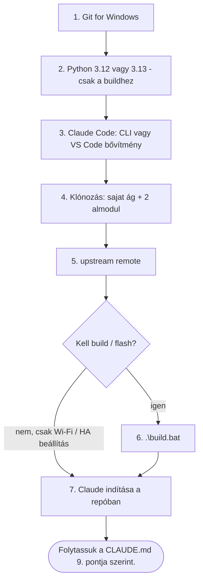

# Munka folytatása egy új gépen (akár VS Code nélkül)

Windowsra írva. Elég hozzá egy friss gép internettel; minden más innen települ.
A munka állapota mindig a repóban van: **`CLAUDE.md` 9. pont** + a `docs/sajat/` napló.



## 1. Git for Windows

Letöltés: <https://git-scm.com/download/win>, telepítés alapbeállításokkal.
Ez hozza a Git Bash-t is, amire a Claude Code-nak Windowson szüksége van.

Első alkalommal állítsd be a neved és az e-mail-címed (a commitokhoz):

```powershell
git config --global user.name  "mbecus"
git config --global user.email "<a GitHub-on használt e-mail címed>"
```

A pusholáskor a Git egyszer bejelentkezést kér a GitHubra (böngészőablak). Ezt a Git Credential Manager megjegyzi.

## 2. Python (csak ha ezen a gépen fordítani is akarsz)

Telepíts **Python 3.12-t vagy 3.13-at** (<https://www.python.org/downloads/>), és pipáld be az „Add Python to PATH” opciót.
**3.14 vagy újabb nem jó:** az ESP32 PlatformIO-platform csak 3.10–3.13-at fogad el.

Ha nincs megfelelő Python, a `build.bat` magától letölt egy hordozható 3.12-t. Abból viszont hiányzik a
`setuptools`, és a build „Failed to build 'rjsmin'” hibával áll meg. Javítás a repó gyökerében:

```powershell
.\.build-python\python.exe -m pip install setuptools wheel
.\.build-python\python.exe -m pip install -r requirements-build.txt
.\build.bat
```

## 3. Claude Code

Két lehetőség közül válassz egyet.

- **Terminálból, VS Code nélkül (CLI):** PowerShellben

  ```powershell
  irm https://claude.ai/install.ps1 | iex
  ```

  Utána nyiss egy **új** PowerShell ablakot, és írd be: `claude`. Első indításkor bejelentkezést kér.
  Ha a parancs időközben megváltozott: <https://docs.claude.com/en/docs/claude-code/setup>
- **VS Code-dal:** telepítsd a VS Code-ot, majd a bővítmények közül a „Claude Code” bővítményt.

## 4. A repó letöltése

Egy tetszőleges mappában, például `D:\Claude_Code\GitHub`:

```powershell
git clone -b sajat https://github.com/mbecus/OTGW-firmware.git
cd OTGW-firmware
git submodule update --init src/libraries/OpenTherm src/libraries/SimpleTelnet
```

A `-b sajat` rögtön a saját munkaágadat veszi elő.
Az almodulok nélkül a build nem fordul le: a két mappa üres marad. Az `other-projects` almodul nem kell.

Ellenőrzés: `git status` → `On branch sajat`; a `src\libraries\OpenTherm\src\OpenTherm.cpp` fájl létezik.

## 5. Az eredeti projekt hozzáadása (upstream)

Ez kell ahhoz, hogy később behúzhasd az eredeti projekt frissítéseit (CLAUDE.md 7. pont):

```powershell
git remote add upstream https://github.com/rvdbreemen/OTGW-firmware.git
```

Az upstream felé soha nem pusholunk.

## 6. Build (csak ha flashelni akarsz)

```powershell
.\build.bat
```

- **Mindig `.\` előtaggal.** Ha a gépen be van állítva a `NoDefaultCurrentDirectoryInExePath` változó, a `cmd` nélküle nem találja a fájlt („is not recognized”).
- Az első build letölti az eszközláncot, ez 10–30 percig is eltarthat.
- A kész fájlok a `build\` mappában lesznek. Ez a mappa nincs a gitben, ezért gépenként újra kell buildelni.

USB flash (új lapkára, vagy ha minden mást törölni akarsz, mert gyári törlést csinál):

```powershell
.\flash_otgw.bat --port COMx --bin "build\OTGW-firmware-esp32-combo-<verzió>-merged-full.bin"
```

A már működő eszközt később a webes felületen, Wi-Fi-n frissítjük (`http://<ip>/update`), USB nélkül.

## 7. Folytatás

```powershell
cd D:\Claude_Code\GitHub\OTGW-firmware
claude
```

(VS Code-ban: nyisd meg a mappát, és indítsd el a Claude panelt.)

Első üzenetnek ennyi elég:

> Folytassuk a CLAUDE.md 9. pontja szerint.

A Claude a `CLAUDE.md`-t minden indításkor magától beolvassa.

## Munkamenet végén, gépváltás előtt

Kérd meg a Claude-ot, hogy frissítse a CLAUDE.md 9. pontját, commitoljon, és pusholjon az `origin`-ra.
A másik gépen kezdés előtt:

```powershell
git pull
git submodule update --init src/libraries/OpenTherm src/libraries/SimpleTelnet
```

## Hasznos eszközök (nem kötelező)

- **Telnet napló** (23-as port): PuTTY (<https://www.putty.org/>), „Telnet” kapcsolattípussal; vagy a Windows
  saját telnet kliense: *Windows-szolgáltatások be- és kikapcsolása → Telnet-ügyfél*, utána `telnet <ip> 23`.
- **Soros port keresése:** Eszközkezelő → *Portok (COM és LPT)*.
